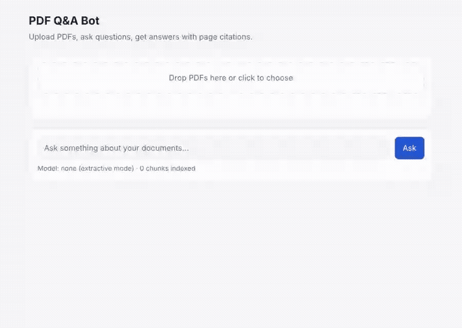
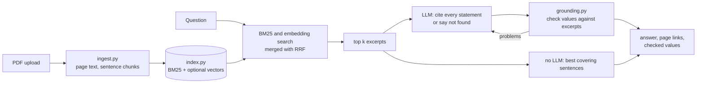

# PDF Q&A Bot

[](https://github.com/mick-gsk/pdf-qa-bot/actions/workflows/ci.yml)

Upload PDFs, ask questions in plain language, and get answers that cite the exact page they came from.
Every number, date and quote in an answer is checked against the cited page before it is shown.
If the answer is not in your documents, the bot says so instead of guessing.



Typical uses: an internal assistant for HR handbooks and policies, a support bot for product manuals,
or quick answers from contracts and reports. The demo runs without an API key, in the extractive mode
described below.

## What it does

- Every statement in an answer is marked `[1]`, `[2]`. Each source links to the cited PDF page.
- Amounts, units, dates, times and quotes in the answer are checked against the cited excerpts.
  Values that no excerpt backs are sent back to the model once for correction; what is still
  wrong afterwards is removed. See [Checking the numbers](#checking-the-numbers).
- If the retrieved excerpts don't contain the answer, the bot replies with a fixed "not found" sentence.
- Answers come from Anthropic Claude, OpenAI or a local model through Ollama, chosen with one
  environment variable, and stream into the page as the model writes. Without an API key the bot
  quotes the best matching sentences instead, so it also works offline.
- Search is BM25 on stemmed keywords, which finds exact names, numbers and error codes. Optional
  embeddings (OpenAI or Ollama) add matching of paraphrases; both rankings are merged with
  Reciprocal Rank Fusion.
- Text is split at sentence boundaries with overlap, and a chunk never crosses a page, so citations
  are exact.
- Answer quality is measured with a question set (`pdfqa eval`), and CI prints the result on every push.

## Quick start

```bash
python -m venv .venv && source .venv/bin/activate
pip install -e ".[anthropic,openai,dev]"

cp .env.example .env           # optional: add an API key
uvicorn pdfqa.api:app --reload # open http://localhost:8000
```

Drop the PDFs from `examples/` onto the page and ask, for example
*"What is the hotel limit in Paris?"* or *"What does error E03 mean?"*

### Docker

```bash
docker build -t pdf-qa-bot .
docker run -p 8000:8000 -e ANTHROPIC_API_KEY=... -v pdfqa-data:/data pdf-qa-bot
```

To run everything locally with Ollama, so no document text leaves the machine:

```bash
docker compose up -d
docker compose exec ollama ollama pull llama3.1
docker compose exec ollama ollama pull nomic-embed-text
```

`render.yaml` deploys the image to Render with a generated `API_TOKEN`.

### Command line

```bash
pdfqa index examples/employee-handbook.pdf
pdfqa ask "How many vacation days do full-time employees get?"
# Full-time employees receive 28 vacation days per calendar year. [1] Part-time employees
# receive vacation days in proportion to their working days. [1]
#   [1] employee-handbook.pdf, p. 1
```

## How it works



| File | Responsibility |
|---|---|
| `pdfqa/config.py` | settings from environment variables and `.env`, validated at startup |
| `pdfqa/ingest.py` | PDF text extraction, cleanup, sentence-based chunking |
| `pdfqa/index.py` | BM25 with stemming, optional embeddings, Reciprocal Rank Fusion, save/load |
| `pdfqa/qa.py` | prompt, citation handling, repair round, streaming, extractive fallback |
| `pdfqa/claims.py` | finds and normalises amounts, units, dates, times and quotes |
| `pdfqa/grounding.py` | checks those values against the cited excerpts |
| `pdfqa/llm.py` | Anthropic, OpenAI and Ollama adapters |
| `pdfqa/store.py` | uploaded files and the index on disk |
| `pdfqa/api.py` | FastAPI routes, token check, request logging, error responses |
| `pdfqa/evaluate.py` | hit@k, MRR, answer accuracy and refusal rate for a question set |
| `pdfqa/grounding_bench.py` | how many wrong values the check catches, and how many correct ones it flags |
| `pdfqa/static/index.html` | the chat page (plain HTML and JavaScript, no build step) |

## Checking the numbers

Telling a model to cite its sources does not stop it from writing "up to 150 euros [1]" when
excerpt [1] says 120. The citation looks right, so nobody checks. `pdfqa/grounding.py` does:

```python
>>> from pdfqa.grounding import verify
>>> sources = ["Hotel costs are reimbursed up to 120 euros per night, or up to 160 euros "
...            "per night in Munich, Paris and London.",
...            "Full-time employees receive 28 vacation days per calendar year."]
>>> for c in verify("Paris: up to €160 [1], 40 euros more than elsewhere [1]. "
...                 "You get 30 vacation days [2].", sources).checks:
...     print(c.text, c.status, c.evidence)
€160 supported Hotel costs are reimbursed up to 120 euros per night, or up to 160 euros per night in Munich, Paris and London.
40 euros derived 160 euros − 120 euros
30 vacation days unsupported
```

Each value gets one of five results: `supported` (in a cited excerpt), `derived` (one calculation
from excerpt values, and the sentence says it is one: "more", "in total", "insgesamt"),
`wrong_citation` (the value is in a different excerpt than the one cited), `unit_mismatch`
("28 days" where the excerpt says 28 euros) or `unsupported`.

Values are normalised before comparing, in English and German: "three weeks" and "3 weeks",
"1,8 l" and "1800 ml", "€120" and "120 euros", "1 January 2026", "01.01.2026" and
"1. Januar 2026". Numbers the user wrote in the question are accepted. The chat page underlines
each checked value in green or red, with the source sentence as a tooltip.

`GROUNDING=repair` (default) gives the model one correction round with the list of problems and
then drops sentences that are still wrong. `GROUNDING=flag` only marks them, `off` skips the check.

How well it works, from `pdfqa bench-grounding`:

| Answers | Mistakes caught | Correct answers flagged |
|---|---|---|
| 31 hand-written, LLM-style (`examples/grounding_cases.json`) | 14 of 15 | 0 of 16 |
| Extractive answers with a planted mistake (`examples/eval.json`) | 44 of 45 | 0 of 19 |

The check compares values, not meaning. It misses a correct value attached to the wrong thing,
such as "30 euros per week" when the handbook says 30 euros per month, and it doesn't check
claims without a number, date or quote.

### Without an LLM

The extractive mode scores each sentence of the retrieved excerpts by how much of the question it
covers, with question words weighted by IDF. A sentence that only shares a common word with the
question ("company", "machine") doesn't count, and below 50% coverage the bot says it found nothing.
That is why "Is there a company car policy?" is refused even though the handbook mentions the company.

## Configuration

Set these as environment variables or in `.env`. Invalid values stop the app at startup with a
message naming the variable.

| Variable | Values | Default |
|---|---|---|
| `LLM_PROVIDER` | `anthropic`, `openai`, `ollama`, `none` | first provider with an API key, else `none` |
| `LLM_MODEL` | any model name of that provider | a small, inexpensive model per provider |
| `EMBEDDINGS` | `openai`, `ollama`, `none` | `none` (keyword search only) |
| `EMBEDDING_MODEL` | model name | `text-embedding-3-small` / `nomic-embed-text` |
| `OLLAMA_HOST` | URL | `http://localhost:11434` |
| `DATA_DIR` | folder for uploaded PDFs and the index | `data` |
| `API_TOKEN` | if set, required as `Authorization: Bearer <token>` | not set (open) |
| `MAX_UPLOAD_MB` | 1 to 500 | `20` |
| `CHUNK_WORDS` | 30 to 1000; re-index after changing | `120` |
| `TOP_K` | excerpts passed to the model, 1 to 10 | `4` |
| `GROUNDING` | `repair`, `flag`, `off` | `repair` |
| `LOG_LEVEL` | `DEBUG`, `INFO`, `WARNING` | `INFO` |

## API

OpenAPI docs are served at `/docs`.

| Method | Path | Purpose |
|---|---|---|
| `POST` | `/documents` | upload one or more PDFs (multipart field `files`) |
| `GET` | `/documents` | list indexed documents |
| `GET` | `/documents/{name}` | download a PDF |
| `DELETE` | `/documents/{name}` | remove one document |
| `DELETE` | `/documents` | remove all documents |
| `POST` | `/ask` | `{"question": "...", "k": 4}` returns answer, sources, checks, mode |
| `POST` | `/ask/stream` | same, as server-sent events: `token` pieces, then `done` |
| `GET` | `/health` | active model and index size (no token needed) |

Every response carries an `X-Request-ID` header that also appears in the log line for that
request. If the model provider fails, `/ask` returns 502 with a readable message.

## Measuring answer quality

`examples/eval.json` has 31 questions about the two example PDFs: 27 with a known page and a phrase
the answer must contain, and 4 that the documents can't answer.

```bash
pdfqa eval examples/eval.json -v
```

Results in extractive mode (no LLM, no embeddings, k = 4):

| Metric | Value |
|---|---|
| Right page among the top 4 excerpts | 26 of 27 (0.96) |
| Mean reciprocal rank | 0.93 |
| Answer contains the expected phrase | 24 of 27 (0.89) |
| Unanswerable questions refused | 4 of 4 |

Two of the three misses are paraphrases such as "How heavy is the machine?" when the manual says
"Weight: 8.2 kg". Keyword search can't bridge that; embeddings or an LLM can. Run the same command
with `LLM_PROVIDER` and `EMBEDDINGS` set to compare setups on your own documents.

## Limits

- Scanned PDFs without a text layer need OCR first; the API rejects them with a clear message.
- The index is a JSON file, which is fine for hundreds of pages. For large document collections,
  swap `Index` for a vector database such as PostgreSQL with pgvector or Qdrant.
- There is no user management. `API_TOKEN` gives one shared token; for per-user access put it behind
  your existing login or a reverse proxy.
- One process owns the index. Run a single worker, or move the index to a database first.

## Development

```bash
pytest --cov   # 136 tests
ruff check .
mypy
```

CI runs these on Python 3.10, 3.12 and 3.13, prints the evaluation and the value-check benchmark,
and builds the Docker image and smoke-tests it.

## License

MIT
