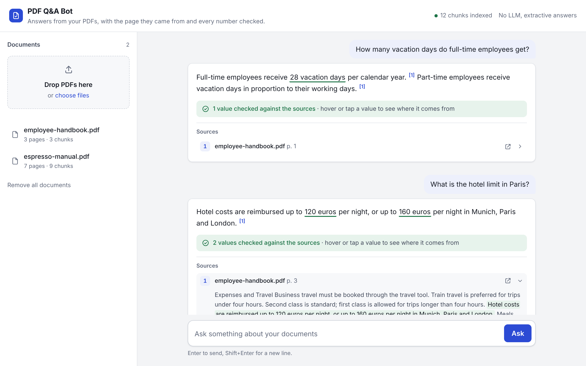

# PDF Q&A Bot

[](https://github.com/mick-gsk/pdf-qa-bot/actions/workflows/ci.yml)

Upload PDFs, ask questions in plain language, and get answers that cite the exact page they came from.
If the answer is not in your documents, the bot says so instead of guessing.



Typical uses: an internal assistant for HR handbooks and policies, a support bot for product manuals,
or quick answers from contracts and reports.

## What it does

- Every statement in an answer is marked `[1]`, `[2]` and linked to the PDF page it came from.
- If the retrieved excerpts don't contain the answer, the bot replies with a fixed "not found" sentence.
- Answers come from Anthropic Claude, OpenAI or a local model through Ollama, chosen with one
  environment variable. Without an API key it runs in an extractive mode that quotes the best
  matching sentences, so the demo works offline.
- Search is BM25 on stemmed keywords, which finds exact names, numbers and error codes. Optional
  embeddings (OpenAI or Ollama) add matching of paraphrases; both rankings are merged with
  Reciprocal Rank Fusion.
- Text is split at sentence boundaries with overlap, and a chunk never crosses a page, so citations
  are exact.
- There is a drag-and-drop chat page, a FastAPI backend with OpenAPI docs at `/docs`, and a CLI.

## Quick start

```bash
python -m venv .venv && source .venv/bin/activate
pip install -e ".[anthropic,openai,dev]"

cp .env.example .env           # optional: add an API key
uvicorn pdfqa.api:app --reload # open http://localhost:8000
```

Drop the PDFs from `examples/` onto the page and ask, for example:
*"How much is the hotel limit in Paris?"* or *"What does error E03 mean?"*

### Docker

```bash
docker build -t pdf-qa-bot .
docker run -p 8000:8000 -e ANTHROPIC_API_KEY=... -v pdfqa-data:/data pdf-qa-bot
```

To run everything locally with Ollama, so no document text leaves the machine:

```bash
docker compose up -d
docker compose exec ollama ollama pull llama3.1
docker compose exec ollama ollama pull nomic-embed-text
```

### Command line

```bash
pdfqa index examples/employee-handbook.pdf
pdfqa ask "How many vacation days do full-time employees get?"
# Full-time employees receive 28 vacation days per calendar year. [1] Part-time employees
# receive vacation days in proportion to their working days. [1]
#   [1] employee-handbook.pdf, p. 1
```

## Configuration

| Variable | Values | Default |
|---|---|---|
| `LLM_PROVIDER` | `anthropic`, `openai`, `ollama`, `none` | first provider with an API key, else `none` |
| `LLM_MODEL` | any model name of that provider | a small, inexpensive model per provider |
| `EMBEDDINGS` | `openai`, `ollama`, `none` | `none` (keyword search only) |
| `OLLAMA_HOST` | URL | `http://localhost:11434` |
| `DATA_DIR` | folder for uploaded PDFs and the index | `data` |
| `API_TOKEN` | if set, required as `Authorization: Bearer <token>` | not set (open) |

## API

| Method | Path | Purpose |
|---|---|---|
| `POST` | `/documents` | upload one or more PDFs (multipart field `files`) |
| `GET` | `/documents` | list indexed documents |
| `DELETE` | `/documents` | remove all documents |
| `POST` | `/ask` | `{"question": "...", "k": 4}` → answer, sources, mode |
| `GET` | `/health` | active model and index size (no token needed) |

## How it works

```
PDF ──► page text ──► sentence chunks (per page, with overlap)
                            │
question ──► BM25 ──┐       ▼
            embed ──┴─► RRF fusion ──► top k excerpts ──► LLM with "cite or say not found" prompt
                                                      └─► (no LLM) best matching sentences
```

| File | Responsibility |
|---|---|
| `pdfqa/ingest.py` | PDF text extraction, cleanup, sentence-based chunking |
| `pdfqa/index.py` | BM25, optional embeddings, Reciprocal Rank Fusion, save/load |
| `pdfqa/qa.py` | prompt, citation handling, extractive fallback |
| `pdfqa/evaluate.py` | hit@k, MRR, answer accuracy and refusal rate for a question set |
| `pdfqa/llm.py` | Anthropic, OpenAI and Ollama adapters |
| `pdfqa/api.py` | FastAPI app and upload handling |
| `pdfqa/static/index.html` | the chat page (plain HTML and JavaScript) |

## Measuring answer quality

`examples/eval.json` has 31 questions about the two example PDFs: 27 with a known page and a phrase
the answer must contain, and 4 that the documents can't answer.

```bash
pdfqa eval examples/eval.json -v
```

Results in extractive mode (no LLM, no embeddings, k = 4):

| Metric | Value |
|---|---|
| Right page among the top 4 excerpts | 26 of 27 (0.96) |
| Mean reciprocal rank | 0.93 |
| Answer contains the expected phrase | 23 of 27 (0.85) |
| Unanswerable questions refused | 4 of 4 |

The four misses are paraphrases such as "How heavy is the machine?" when the manual says
"Weight: 8.2 kg". Keyword search can't bridge that; embeddings or an LLM can. Run the same command
with `LLM_PROVIDER` and `EMBEDDINGS` set to compare setups on your own documents.

## Limits

- Scanned PDFs without a text layer need OCR first; the API rejects them with a clear message.
- The index is a JSON file, which is fine for hundreds of pages. For large document collections,
  swap `Index` for a vector database such as PostgreSQL with pgvector or Qdrant.
- There is no user management. `API_TOKEN` gives one shared token; for per-user access put it behind
  your existing login or a reverse proxy.

## Tests

```bash
pytest        # 28 tests: parsing, retrieval, answers with a fake LLM, the API, the evaluation
ruff check .
```

## License

MIT
